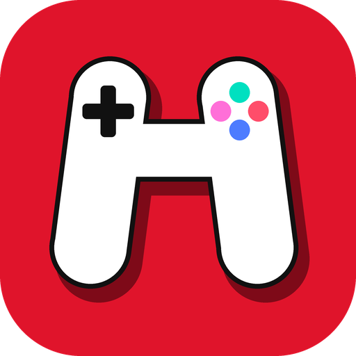
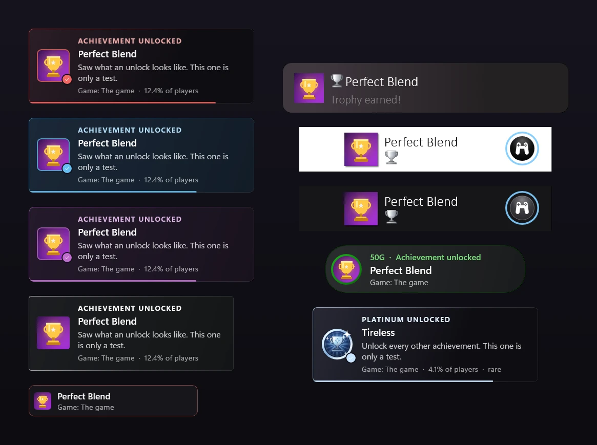

  

<h1 align="center">Hybrid Launcher</h1>

  <b>A modern game launcher that properly manages popular mods, built with customization and tons of quality of life options in mind.</b> 
  Steam · Epic Games · GOG · Xbox / Game Pass · Ubisoft Connect · EA app · Rockstar Games Launcher · your own folders

  
  &nbsp;
  
   
  

  
  
  
  

**🧭 Jump to:** [🎮 What it is](#what-is-hybrid-launcher) · [📦 Quick start](#quick-start) · [✨ Features](#features) · [❓ FAQ](#faq) · [🔒 Privacy](#privacy) · [🐞 Report a bug](#reporting-bugs) · [☕ Support](#support-the-project) · [📜 License](#license) · [⚠️ Disclaimer](#disclaimer)

---

## What is Hybrid Launcher

A free and open source Windows 11 app that **finds the games on your PC**, gives each one **its own page**, and installs the
mods that make them run and look better: **OptiScaler** first of all, then **ReShade**, **RenoDX**, **Luma**, **DXVK** and,
in early and experimental form, **DLSS 5**. A launcher and a mod tool in one window, for several stores at once.

  

> [!IMPORTANT]
> **Not a beginner-first app.** It is meant for people with some modding experience: know the mods it handles and how
> they change your game folder, and you will get much more out of it.

## Quick start

1. **Download** `HybridLauncher-<version>-win-x64.zip` from [Releases](https://github.com/LorenzoKy/Hybrid-Launcher/releases/latest).
2. **Extract** it anywhere you can write, for example `C:\Games\Hybrid Launcher`.
3. **Run** `HybridLauncher.exe`, choose the features you want, then pick a game and install a mod from its tabs.

Windows 11 (or an up-to-date Windows 10), 64-bit. Nothing to install: the runtime ships in the `app` folder, settings live
in `%LOCALAPPDATA%\HybridLauncher`, and the app updates itself after asking once.

## Features

**Your games**
- **One library** for Steam, Epic Games, GOG, Xbox / Game Pass, Ubisoft Connect, the EA app, the Rockstar Games Launcher and your own folders: covers, play time, achievements,
  pins, search, filters, renaming, a Last played section, Play on every cover, custom covers, drag and drop, controller support.
- **A page per game** that opens on its **Dashboard**: trailer, the newest update with its patch notes read in the app,
  news, Steam's version history, your activity and achievements, the mods in its folder, reviews, HowLongToBeat and
  PCGamingWiki. Every card folds, and the gear picks which cards show and their order; tabs for each mod, notes, links
  and quick access follow.
- **Direct downloads** from your Steam, Epic and GOG accounts, with pause, resume and updates that leave your mods in place.
- **Cloud saves** on OneDrive, MEGA or a folder (Google Drive, a NAS, a USB drive), one or several at once, with history and conflict handling.

**Mods**
- **OptiScaler** through its own installer, with a quick panel, profiles, saved versions, custom builds and
  **custom DLLs** (extra FSR, DLSS or DLSSG dlls per game).
- **Forks/Unofficial Builds** of OptiScaler beside Stable and Nightly (add any fork by its GitHub address), an
  **Update available** button when a newer build of yours is out, and optional notifications per channel or fork. The settings
  a fork adds to OptiScaler.ini get switches, sliders and lists like the official ones, marked *this build only*.
  Builds that need NVIDIA's DLSS NR model file get it from one copy you pick once, on for every game or only some.
- **Ultra+** for Unreal Engine games *(experimental)*: install, update, add-ons and its settings from the game's Ultra+ tab,
  with automatic updates and notifications if you want them. It is new and tried on few games so far; *Uninstall* puts the
  folder back as it was.
- **Mods tab**: one table of every mod in the game folder, its version, what loads it, whether it works and who put it
  there, with Open and Uninstall on each line; then **ReShade, RenoDX and Luma**, matched to the game where possible
  (removal keeps your presets).
- **DLSS 5** *(early, experimental)*: step-by-step setup of DLSS 5 neural rendering with mochizuki0323's **DLSSNR-AMD**
  (Radeon RX 9000, RX 7000 experimental; through OptiScaler or ReShade) and janblade's **F5 Multipass** (NVIDIA NGX, or a
  vendor-neutral port), from NVIDIA's model file you pick once. Young community projects: expect games where it does not
  work yet.
- **Auto tab** *(experimental)*: reads the game (bitness, graphics API, graphics card, HDR) and proposes the mods that fit,
  each with its build (OptiScaler's source and version, DLSS 5's method, ReShade standard or add-on, picked for you when
  RenoDX needs it), then installs them together in the right order. Installing each mod from its own tab is still the
  recommended way.
- **DXVK, DXVK-gplasync and VKD3D-Proton**: Direct3D 8 to 12 run through Vulkan, with the right dlls for the game's
  Direct3D version and bitness, async, HDR and a frame cap as switches, and the game's own files put back on uninstall.
- **What is installed as what**: every mod file beside the game exe, which mod it is, its version and what loads it. The
  page follows the folder, so a mod added or removed by hand shows at once.
- **OptiScaler's file name** (dxgi.dll, winmm.dll, version.dll…) changed in place without reinstalling, and its settings
  described in plain words.
- **Mod check**: a warning on the game's banner when something keeps a mod from loading (a game update removed it, ReShade
  loads twice, RenoDX without the add-on build of ReShade, DXVK without its dxgi.dll), with a button that fixes it.
- **Backups** of every file a mod replaces, so removing it puts the game back.
- **Smart HDR**: Windows HDR on when the game starts, off when it closes.
- **Update notifications** in one list beside Minimize, with Windows pop-ups you choose per source (OptiScaler builds you
  follow, Ultra+, Hybrid Launcher itself), held back while a game runs.

**Extras**
- **Achievement pop-ups** that look like a console's or a store's (PlayStation 5, PlayStation 4, Xbox, Steam, GOG, Epic, all
  *Like* looks drawn by Hybrid Launcher) or your own: bronze, silver or gold by rarity, the game's own platinum, your own sounds
  per tier, a light, dark or coloured background for the PlayStation looks, a preview with a real game. Steam, Xbox / Game
  Pass, local and GOG achievements are read; each unlock can save a screenshot, rumble the controller and go into an
  unlock history you can export.
- **Local achievements**: games that keep their achievements in save files on this PC show them on the game page and
  unlock them with the same pop-ups as Steam and GOG. Cloud saves carry them along with the saves. On by default, in
  Settings → Achievements → *Sources*.
- **Controller**: every button can be given another action, and the optional **Home button** (Xbox / PS) brings Hybrid
  Launcher forward from a game; pressed on an achievement pop-up, it opens that achievement, as a console does.
- **Quick access** shortcuts per game, **My PC** with your hardware and driver upscaler versions, tray mode (the window steps aside
  while a game runs and comes back when it closes), start with Windows, a welcome tour and a one-click bug report.
- **Smooth scrolling and vsync, always on**: the mouse wheel glides instead of jumping and answers at the next frame, and
  everything the app moves by itself (scrolling, the controller's right stick, the achievement pop-ups) moves once per
  refresh of your display, at 60, 120, 144 Hz or more.
- **Light on your PC**: with another window in front it rests (clips paused, Windows efficiency mode) and wakes up the moment
  you click it; games open in an instant.
- **Search all settings** from the box beside the Settings title, and **your play time is kept** even when you reinstall or
  move a game.
- **Interface size** from 50 to 200%, scroll bars shown or hidden, Shading on or off, and Settings' tabs as a list.
- **Make it yours**: keep only the features you need (*Everything*, *Only OptiScaler*, *Just a launcher*…), and toggle,
  drag or hide tabs, launch bar items and colour themes, including the warm *Cozy* theme.

  

  

## FAQ

<b>Do I need to sign in to my stores?</b>

No. Without accounts it reads the games your launchers installed. Signing in only adds direct downloads and your full
owned library.

<b>Can I go back to the original game files?</b>

Yes, when the backup is on (the default): removing a mod puts back the files it replaced.

<b>Can mods get me banned?</b>

They can, in games and services that forbid them. Never use mods in online or competitive games that do not allow them.

<b>Can I build it, change it or fork it?</b>

Yes, it is GPL v3: see the [license](#license).

## Troubleshooting

Every error in the app is shown in red with a **Possible causes** line under it and a **Troubleshooting** link to the
right section of the [troubleshooting guide](docs/troubleshooting.md). The usual ones:

| Problem | First thing to check |
|---|---|
| Cloud saves: *in OneDrive but not in MEGA yet* | One cloud missed this copy (offline, or MEGA's sign-in ended); it catches up at the next sync. [More](docs/troubleshooting.md#cloud-saves) |
| Cloud button never says *Synced* | Press **Sync now** from the game's Cloud button; sign in to MEGA again if it asks. [More](docs/troubleshooting.md#cloud-saves) |
| *Start with Windows* does nothing | It starts in the notification area (look under the arrow by the clock); check it is on in Windows' **Settings → Apps → Startup**. [More](docs/troubleshooting.md#start-with-windows) |
| *Access denied* / *file in use* | Close the game and its launcher; let OneDrive or the antivirus finish with the folder. [More](docs/troubleshooting.md#common-windows-errors) |
| OptiScaler does not show up in the game | Try another dll name (dxgi, winmm, version…) in the setup options. [More](docs/troubleshooting.md#mods-optiscaler-and-reshade) |
| A game does not start | Is it still running? Is the right exe picked (gear beside Play → *Change game exe*)? [More](docs/troubleshooting.md#a-game-does-not-start) |

## Privacy

What the app stores and sends: [Privacy and data](docs/privacy.md).

## Reporting bugs

> [!WARNING]
> **Reports and requests are only considered when they are detailed, understandable and come with logs and
> screenshots.** Anything else is ignored.

The quickest way: **Settings → About → Report on GitHub** in the app. It fills in the version, your system and the end of
the log (with your user name, PC name and e-mails taken out) and nothing is sent until you submit. Otherwise use the
[issue templates](https://github.com/LorenzoKy/Hybrid-Launcher/issues/new/choose); logs are in
`%LOCALAPPDATA%\HybridLauncher\logs`.

Collaborations and business enquiries: [lorenzoillumino@gmail.com](mailto:lorenzoillumino@gmail.com) or **LorenzoKy** on
Discord.

## Support the project

Hybrid Launcher is **free**. For now it is funded **only out of my own pocket, and those funds are limited**: there is
**no guarantee it will keep going**. Your support could make that possible: [Ko-fi](https://ko-fi.com/lorenzoky) or the
**Sponsor** button of this repository. Contributors and maintainers are welcome too.
Thank you.

## Third-party software

**I make and own only Hybrid Launcher.** Everything it downloads, installs, runs, reads or links to (mods, tools, games,
stores, services, fonts and libraries) belongs to its own authors and owners, under their own licenses and terms, and each
one's problems belong to its own project. None of them is affiliated with Hybrid Launcher or endorses it, and all trademarks
belong to their owners. Looks inspired by consoles or stores are Hybrid Launcher's own drawings and are not affiliated with
the companies behind them.

Signing in to a store with a third-party app may be against its terms in some cases: the choice is yours.

## License

Free and open source under the **[GNU General Public License v3](LICENSE)**: use it, read it, change it, fork it, share
it. Forks and unofficial builds must stay GPL v3 and show *Based on Hybrid Launcher by LorenzoKy* with a link to this
repository (a section 7(b) term, see [NOTICE.md](NOTICE.md)). Third-party libraries and mods keep their own licenses.

## Disclaimer

**By downloading or using Hybrid Launcher you accept this disclaimer.** It is provided **"AS IS"**, without warranty of
any kind, and **you use it entirely at your own risk**.

<b>Read the full disclaimer</b>

- Hybrid Launcher is provided "AS IS", without warranty of any kind, express or implied, including but not limited to the
  warranties of merchantability, fitness for a particular purpose and non-infringement.
- **I guarantee nothing**: not that it works, not that it works on your PC or with your games, not that it is free of bugs,
  not that it will be updated, fixed or supported.
- **You alone are responsible** for its use and for what follows from it, including but not limited to: damaged or deleted
  game files, lost or corrupted saves, broken game installs, problems with anti-cheat systems, suspended or banned
  accounts, lost data, hardware or software issues.
- Mods change how games run. Some games and online services do not allow them. **Check the rules of every game and service
  before you mod it**, and never use mods in online or competitive games that forbid them.
- In no event shall the author be liable for any claim, damages or other liability, whether in an action of contract, tort
  or otherwise, arising from, out of or in connection with the software or its use.
- Back up what matters to you (saves, game folders, settings) before using any feature that changes it.
- **This project is built with the use of AI.** That does not mean it takes no time, design or money: planning it, testing
  it and fixing it still take time, and the tools are paid for. It also means the code can contain mistakes, one more reason
  the points above apply.

If you do not agree with all of the above, do not use Hybrid Launcher.

---

Made by <a href="https://github.com/LorenzoKy">LorenzoKy</a>.

